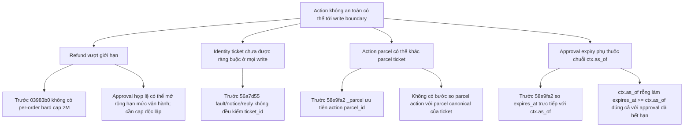

# TV2 Guard Engineering: specification, review, and handover

> Phạm vi: bàn giao kỹ thuật phần Guard TV2. Bản ghi ban đầu được soạn trước khi nhóm nhận S5; sau đó `origin/main` đã tích hợp thẻ S5, hồ sơ incident và kết quả tổng hợp. Tài liệu này giải thích Guard và các kiểm soát liên quan; Phiếu C/S5 chính thức nằm trong `submission/docs/form-c-incident.md`, kết quả tích hợp trong `submission/REPORT.md` và `docs/s5-fix-report.md`. Không thay thế hoặc viết lại hồ sơ của các owner đó.

## Trạng thái và bằng chứng kiểm tra

- Nhánh TV2 `LeDoanDuong` được nhập cùng `origin/main` tới commit tích hợp hiện tại; lịch sử Guard TV2 gồm `937e234`, `03983b0`, `4ef1272`, `56a7d55`, `58e9fa2`. Main có cập nhật tiếp theo, gồm `689653c` cho đối soát refund theo order và `d38ceff` cho hồ sơ S5.
- Lần chạy mới nhất dưới đây dùng code/test trên merge tree tích hợp; không thay đổi acceptance criteria/lock.
- Không chạy evaluation/grade/checkpoint trong lượt merge này. Giữ nguyên cấu hình, monitors, snapshots và submission từ `origin/main`.

## C5 — Technical Specification (mức hệ thống)

### Vị trí trong kiến trúc

Trong `lab10/agent.py`, `run_ticket()` gọi `pre_guard(ctx)` trước khi Agent xử lý nội dung ticket. Khi workflow gọi công cụ ghi, `lab10/tools.py` chuyển action qua `write_gate(ctx, action)` trước khi thay đổi ledger, carrier fault, thông báo hoặc reply. `write_gate` dispatch tới `_refund_gate`, `_fault_gate`, `_carrier_notice` và `_customer_reply`; lỗi bất ngờ trong guard được chuyển thành `Verdict.escalate`, không thành allow. `deny` chặn lần ghi tương ứng; `escalate` chuyển xử lý sang người. Refund hiện được ghi trước carrier fault và notice trong Agent, nên Guard phải kiểm tra refund ngay ở ranh giới ghi.

Nguồn xác thực của Guard là ticket trong context và dữ liệu đọc qua `ctx.tools` (order/customer, parcel tracking, policies, approvals, ledger và operating limits). Action của Agent và lời khách không được xem là bằng chứng tracking. Policy được chọn theo ngày có hiệu lực; `pre_guard` trả `policy_id` đã pin để Agent sử dụng.

### Đặc tả các cổng

| Guard | Mục tiêu, input và kiểm tra | Allow / deny / failure | Bằng chứng test |
|---|---|---|---|
| `pre_guard` / `_effective_policy` | Đọc ngày từ `ctx.as_of`, fallback `ctx.tools.as_of`; chọn policy hiệu lực từ policy store. | Allow và pin `policy_id` khi policy xác minh được; thiếu policy/ngày hợp lệ thì escalate. | `test_pre_guard_pins_effective_policy`; `test_missing_or_invalid_context_and_tools_dates_never_allow_refund` |
| `_refund_gate` — hard cap và sổ cái | Bác bool, số không nguyên, <=0; amount > 2.000.000 bị deny. Đọc ledger theo order để phát hiện hoàn trùng liên ticket/manual, kiểm dữ liệu ledger hợp lệ, tổng tiền đã trả và phần entitlement còn lại; refund một phần được `modify` xuống số dư quyền lợi còn lại. | Hard cap áp dụng cả khi có approval; tổng ledger + khoản mới không vượt 2.000.000. Sau đối soát vẫn phải thỏa identity, parcel, policy, payer, approval, operating limits và duplicate checks. | Hard cap: `test_refund_2000001_is_denied_with_hard_cap_log`, `test_refund_2000000_passes_hard_cap_then_normal_checks`, `test_valid_approval_cannot_exceed_hard_cap`, `test_valid_approval_cannot_push_order_total_over_hard_cap`. Order reconciliation: các test trong `tests/test_refund_reconciliation.py`. |
| `_refund_gate` — identity/parcel/entitlement | Ticket/order action phải bằng ticket hiện tại; order phải thuộc customer ticket; parcel canonical là `ticket.parcel_id` nếu có, nếu không dùng helper chọn parcel trễ nhất theo tracking; action parcel nếu được gửi phải khớp. Tính delay/cause/entitlement từ tracking và policy, payer phải `LOGIX`. | Sai ticket/order bị escalate; parcel mismatch bị deny; thiếu dữ liệu xác minh bị escalate; vượt entitlement hoặc không có quyền lợi bị deny. | `test_wrong_order_or_payer_is_blocked`, `test_refund_rejects_mismatched_ticket_id`, `test_refund_denies_action_parcel_different_from_ticket_parcel`, `test_refund_uses_tracking_not_customer_claim`, `test_ticket_parcel_p1_still_allows_valid_refund_fault_and_notice` |
| `_refund_gate` — approval và hạn mức | Approval phải khớp ticket, order, customer, status=`valid`, max_vnd >= amount và `expires_at >=` ngày tham chiếu hợp lệ. Ngoài ra kiểm tổng order, hạn mức customer/day, finance/day và duplicate ticket. | Approval không thay thế hard cap/entitlement. Approval thiếu, hết hạn hoặc sai phạm vi thì không allow; thiếu ngày tham chiếu thì fail closed (escalate). Không xác minh được limits thì escalate. | `test_exact_valid_approval_allows_policy_entitlement`, `test_expired_approval_uses_tools_date_when_context_date_empty_or_invalid`, `test_unexpired_approval_uses_tools_date_fallback`, `test_unverified_approval_cannot_bypass_auto_limits` |
| `_fault_gate` | Ticket ID/order/customer phải khớp; parcel phải canonical; delay tính từ promised/delivered/as_of; delay đạt `policy.late.min_days_fee`; cause nằm trong `policy.fault_causes`; carrier và delay action khớp parcel/tracking. | Chỉ allow khi toàn bộ bằng chứng chính thức khớp. Thiếu/sai bằng chứng, ticket sai hoặc parcel khác đều deny. | `test_carrier_fault_requires_canonical_delay_and_cause`, `test_fault_denies_action_parcel_different_from_ticket_parcel`, `test_non_refund_writes_reject_mismatched_ticket_id` |
| `_carrier_notice` | Kiểm ticket ID, customer của order gắn với ticket, carrier và canonical parcel. Không dùng `payload.order_id` do Agent gửi để xác thực; payload đầu ra được dựng lại với order/parcel canonical, tracking và allowlist policy. Không chuyển tiếp customer note hay recipient contact. Ngày không xác minh được hoặc không còn trường hợp lệ thì deny. | Payload sai kiểu/parcel/recipient bị deny; payload hợp lệ được `modify` thành bản tối thiểu. | `test_carrier_notice_is_minimized_from_verified_facts`, `test_notice_denies_action_parcel_different_from_ticket_parcel`, `test_non_refund_writes_reject_mismatched_ticket_id` |
| `_customer_reply` | Ticket/order/customer/recipient phải cùng chủ đơn; text phải là string. Regex email/phone và name/phone/street đã biết từ customer/recipient bị ẩn. | Sai người nhận hoặc sai kiểu text bị deny; phát hiện PII thì modify đã redacted; nếu không phát hiện pattern thì allow. | `test_reply_redacts_contact_details_and_rejects_wrong_recipient` |
| `write_gate` | Dispatch theo tool; unknown write bị deny; exception trong kiểm tra log loại lỗi và escalate. | Mọi nhánh bình thường của `write_gate` hiện trả Verdict; exception được escalate. Lưu ý `WriteTools._gate` có fallback allow nếu guard trả `None`, nhưng guard hiện tại không có nhánh trả `None`. | `test_write_gate_denies_unknown_tool`, `test_write_gate_escalates_guard_exception`; chưa có test cho guard trả `None` qua `WriteTools._gate`. |

### Kiểm soát và giới hạn được code chứng minh

Guard ngăn refund sai ticket/order/customer, vượt quyền lợi policy, sai payer, vượt hard cap 2 triệu mỗi order, vượt tổng order cap, dùng approval không hợp lệ/hết hạn, hoặc replay ticket đã có ledger row. Fault phải có recorded cause thuộc policy, delay/carrier đúng với parcel canonical. Carrier notice chỉ nhận dữ liệu operational được policy cho phép. Reply redaction chỉ bao phủ email/phone theo regex và các trường định danh đã tra từ order/customer; đây không phải bộ nhận diện PII tổng quát và không bảo đảm bắt mọi dạng dữ liệu cá nhân.

## C6 — Root cause analysis trước sửa (code-level, không gán cho incident)

Các nhánh dưới đây đối chiếu code ở parent commit của remediation tương ứng. Chúng mô tả lỗ hổng implementation trước sửa; chưa có incident card để khẳng định chúng đã xảy ra trong một incident cụ thể.

| Hiện tượng / kích hoạt | Nguyên nhân trực tiếp và gốc ở code | Hành vi/tác động có thể có | Bằng chứng lịch sử |
|---|---|---|---|
| Refund lớn hơn 2.000.000 trong phạm vi số tiền order đã thanh toán; hoặc approval lớn làm lách giới hạn auto | Trước `03983b0`, `_refund_gate` không có cap tuyệt đối per order; approval hợp lệ làm bỏ qua customer/day và finance/day auto limits. `WriteTools` vẫn có host check tổng refund không vượt tổng tiền đã thanh toán, nhưng không có trần riêng 2.000.000 VND. | Có thể ghi khoản hoàn vượt hard cap đã chốt (nếu giá trị order cho phép), gây tổn thất tài chính. | `git show 03983b0^:lab10/guards.py` không có `MAX_REFUND_PER_ORDER_VND` hay kiểm tổng order; `lab10/tools.py::WriteTools.issue_refund` chỉ giới hạn tổng theo số tiền đã thanh toán; commit `03983b0` thêm cap. |
| Fault/notice có ticket ID action khác ticket context | Trước `56a7d55`, refund so ticket/order, nhưng `_fault_gate`, `_carrier_notice` thiếu so ticket ID rõ ràng (và reply cũng thiếu ticket check). | Có thể gắn thao tác với phiếu sai; sai attribution hoặc gửi thông báo ngoài ticket. | So `56a7d55^:lab10/guards.py` với `56a7d55:lab10/guards.py`. |
| Ticket P1, action chỉ định P2 | Trước `58e9fa2`, `_parcel(order, parcel_id, ctx)` ưu tiên `parcel_id` của action nếu có; không buộc action parcel bằng `ticket.parcel_id`. | Có thể tính refund/fault/notice theo parcel khác với kiện ticket đề cập. | `git show 58e9fa2^:lab10/guards.py`; regression fixture P1 đúng hạn/P2 trễ được thêm ở commit `58e9fa2`. |
| `ctx.as_of` rỗng, approval đã hết hạn | Trước `58e9fa2`, expiry được so bằng chuỗi trực tiếp `approval.expires_at >= ctx.as_of`; kiểm tra expiry không dùng fallback `ctx.tools.as_of`. Khi `ctx.as_of == ""`, mọi chuỗi expiry không rỗng so sánh lớn hơn chuỗi rỗng, nên approval hết hạn có thể qua bước expiry. | Có thể cho phép refund với approval đã hết hạn nếu các điều kiện khác đều hợp lệ. | `git show 58e9fa2^:lab10/guards.py` cho thấy so sánh chuỗi trực tiếp; test hiện hành `test_expired_approval_uses_tools_date_when_context_date_empty_or_invalid` tái hiện và xác nhận bị chặn sau sửa. |
| Customer PII trong carrier notice (baseline trước Guard TV2) | Agent tạo payload có `customer_note`, và với gift còn có recipient contact; baseline write guard cho phép action mà không lọc payload. Guard TV2 hiện tại dựng lại payload từ allowlist. | Ở baseline trước các Guard TV2, nội dung khách/người nhận có nguy cơ chuyển cho carrier; đây là đường dữ liệu có thể xảy ra, không phải sự cố đã quan sát. | `lab10/agent.py` payload sau fault; baseline `git show 937e234^:lab10/guards.py` và phần minimization ở Guard sau đó; `test_carrier_notice_is_minimized_from_verified_facts`. |

## C7 — Technical Remediation

| Root cause | Remediation đã có | File/function | Test liên quan | Trạng thái |
|---|---|---|---|---|
| Thiếu cap tuyệt đối trên amount | Hằng `MAX_REFUND_PER_ORDER_VND=2_000_000`; deny amount vượt cap trước approval; kiểm cả cumulative ledger total. | `lab10/guards.py::_refund_gate` | `test_refund_2000001_is_denied_with_hard_cap_log`; `test_refund_2000000_passes_hard_cap_then_normal_checks`; `test_valid_approval_cannot_exceed_hard_cap`; `test_valid_approval_cannot_push_order_total_over_hard_cap` | Đã triển khai; kiểm chứng bằng test. |
| Approval có thể bị xem là đủ để bỏ cap | Hard cap đứng độc lập, kiểm trước approval; cap tích lũy cũng không bị bỏ qua khi approval_valid. | `lab10/guards.py::_refund_gate` | `test_valid_approval_cannot_exceed_hard_cap`; `test_valid_approval_cannot_push_order_total_over_hard_cap` | Đã triển khai; kiểm chứng bằng test. |
| Ticket/action identity không nhất quán | So ticket ID trong refund/fault/notice/reply; order và customer phải khớp context. | `lab10/guards.py` các write gates | `test_non_refund_writes_reject_mismatched_ticket_id` kiểm tra fault/notice/reply; `test_refund_rejects_mismatched_ticket_id` kiểm tra refund sai ticket; `test_wrong_order_or_payer_is_blocked` kiểm tra refund sai order/payer. | Đã triển khai; có test trực tiếp cho từng nhánh identity đã nêu. |
| Action parcel khác parcel của ticket | `_ticket_parcel` chọn parcel theo ticket nếu có; nếu không, helper chọn parcel trễ nhất theo tracking. `_parcel` báo mismatch, các gate refund/fault/notice deny; không xác định được parcel thì không allow. | `lab10/guards.py::_ticket_parcel`, `_parcel`, `_refund_gate`, `_fault_gate`, `_carrier_notice` | `test_refund_denies_action_parcel_different_from_ticket_parcel`, `test_fault_denies_action_parcel_different_from_ticket_parcel`, `test_notice_denies_action_parcel_different_from_ticket_parcel`; `test_ticket_parcel_p1_still_allows_valid_refund_fault_and_notice` | Đã triển khai; kiểm chứng bằng test. |
| Ngày expiry thiếu/sai hoặc `ctx.as_of` rỗng | `_as_of_date` parse ngày context trước, sau đó fallback tools; approval expiry parse thành ngày; thiếu ngày xác minh làm policy/refund escalate. | `lab10/guards.py::_as_of_date`, `_effective_policy`, `_refund_gate` | `test_expired_approval_uses_tools_date_when_context_date_empty_or_invalid`; `test_missing_or_invalid_context_and_tools_dates_never_allow_refund`; `test_impossible_context_calendar_date_falls_back_to_valid_tools_date`; `test_unexpired_approval_uses_tools_date_fallback` | Đã triển khai; ngày lịch không tồn tại bị parser từ chối; kiểm chứng bằng test. |
| Carrier notice nhận dữ liệu do Agent cung cấp | Guard dựng payload mới từ facts canonical và field allowlist của policy. | `lab10/guards.py::_carrier_notice` | `test_carrier_notice_is_minimized_from_verified_facts` | Đã triển khai; kiểm chứng bằng test. |
| Hoàn trùng giữa ticket khác nhau/hoàn tay một phần (bổ sung trong tích hợp main, `689653c`) | Đọc ledger authoritative theo order, fail closed nếu ledger malformed, ngăn trả lại quyền lợi đã chi và chỉ trả phần còn lại. Đây là remediation tích hợp sau các commit Guard ban đầu, không gán riêng cho nhánh TV2. | `lab10/guards.py::_refund_gate` | `test_new_ticket_cannot_repay_fully_refunded_order`, `test_partial_manual_refund_only_pays_balance_and_reports_it`, `test_two_different_requests_share_order_entitlement`, `test_unparseable_ledger_is_handed_to_reconciliation` | Có code và test trên merge tree. |
| PII trong customer reply | Ẩn email/phone theo regex và dữ liệu định danh đã biết; xác minh recipient trước gửi. | `lab10/guards.py::_customer_reply` | `test_reply_redacts_contact_details_and_rejects_wrong_recipient` | Đã triển khai với phạm vi phát hiện giới hạn; không bảo đảm nhận diện mọi PII. |

Lý do fail-closed: thiếu identity, tracking, policy, approval date hoặc operating limit thì Guard không có bằng chứng để chứng minh write an toàn. Với refund, một allow sai có thể tạo tác động tài chính không thể thu hồi bởi các bước fault/notice sau đó; với fault, bằng chứng không đủ có thể gây ghi lỗi oan; với notice, payload tối thiểu giảm dữ liệu rời khỏi hệ thống.

## C9 — Root cause analysis sau sửa

### A. Đã khắc phục và có test

- Amount > 2.000.000 bị deny; amount đúng cap không bị cap tự nó từ chối; approval không vượt được cap, gồm cap cộng dồn order.
- Ticket ID sai trên refund/fault/notice/reply đều có test trực tiếp. Parcel action khác canonical ticket được test riêng trên refund, fault và notice.
- Approval expiry dùng ngày chuẩn từ context hoặc fallback trusted tools; ngày thiếu/sai không được phép tạo allow.
- Carrier notice được dựng lại từ trường canonical/allowlisted; reply có recipient guard và redaction các pattern đã biết.
- Main tích hợp thêm reconciliation theo order: ticket khác không thể thanh toán lại entitlement đã dùng, hoàn tay một phần chỉ được trả số còn lại, ledger malformed được chuyển đối soát, và carrier fault bị replay sẽ bị deny. Các test tương ứng nằm trong `tests/test_refund_reconciliation.py`; đây là phần tích hợp `689653c`, không quy công cho commit TV2 gốc.

### B. Guard chặn an toàn nhưng lỗi tích hợp bên ngoài vẫn còn

Trong `lab10/agent.py`, Agent tính `worst = max(parcels, key=delay)` và lấy `delay/cause` từ parcel này (khoảng dòng 113–115), nhưng khi gọi `file_carrier_fault` dùng `first = parcels[0]` cho `parcel_id` và `carrier_id` (khoảng dòng 194–198). Guard kiểm parcel/carrier/delay so với parcel canonical của ticket (ticket parcel nếu có, nếu không thì parcel trễ nhất). Vì vậy, khi ticket không chỉ định parcel và parcel đầu khác parcel trễ nhất, ID/carrier action lệch; khi ticket chỉ định parcel đầu nhưng parcel trễ nhất khác, ID có thể khớp nhưng `delay_days` vẫn lệch. Cả hai trường hợp đều có thể khiến Guard deny fault. Notice sau fault chỉ chạy nếu fault write thành công. Refund được thử trước đó nên có thể đã được ghi, trong khi fault/notice bị bỏ qua.

Khuyến nghị cho owner Agent (TV2 không sửa workflow ngoài phạm vi): chọn một parcel duy nhất, rồi lấy `parcel_id`, `carrier_id` và `delay_days` từ chính parcel đó cho fault; payload notice phải tiếp tục dùng parcel từ kết quả fault/cùng lựa chọn đó. Không nới Guard để hợp thức hóa parcel không nhất quán. Test hiện tại xác nhận ticket P1 cụ thể vẫn allow hợp lệ; chưa có end-to-end test chứng minh Agent chọn cùng parcel trong trường hợp nhiều parcel.

### C. Chưa xử lý / còn giới hạn

- S5 hiện là thẻ được giao theo `TEAM.md`; tài liệu C và kết quả grade đã được nhóm lưu ở `submission/docs/form-c-incident.md`, `submission/REPORT.md` và `docs/s5-fix-report.md`. Báo cáo TV2 này là phần giải thích Guard, không thay thế các mục incident-specific trong hồ sơ đó. Không suy đoán nội dung S1–S4 hoặc S6–S8. Lượt tích hợp này không chạy lại incident grade.
- `_as_of_date` gọi `H.d` → `date.fromisoformat`. Regression hiện chứng minh ngày lịch không tồn tại `2026-02-30` không được dùng và dẫn tới fallback hợp lệ hoặc fail closed. Python cũng chấp nhận ISO basic/week-date forms như `20260228` và `2026-W09-6`; nếu hợp đồng yêu cầu đúng cú pháp `YYYY-MM-DD`, cần thêm kiểm tra định dạng regex.
- Reply PII filter là regex + danh sách giá trị đã biết, có thể bỏ lọt biến thể/PII chưa có trong DB.
- Approval hợp lệ không vô hiệu hóa cap order, nhưng có thể thay đổi áp dụng auto customer/day limit theo thiết kế hiện tại; business owner cần xác nhận các policy/limit đó.
- `deny` là theo từng write. Vì Agent ghi refund trước fault/notice, chặn fault không rollback refund đã ghi.

## Demo TV2 (2–3 phút)

1. **Kiến trúc (20–30 giây):** Agent tạo action; `WriteTools` đưa action qua `write_gate` trước khi write; Guard xác minh dữ liệu tin cậy và trả allow/deny/escalate/modify.
2. **Refund > cap (30 giây):** chạy `python3 -m unittest tests.test_guards.GuardChecks.test_refund_2000001_is_denied_with_hard_cap_log -v`; nêu rõ log cap và deny xảy ra cả khi approval không làm thay đổi giới hạn tuyệt đối.
3. **Ticket P1, action P2 (30 giây):** chạy `python3 -m unittest tests.test_guards.GuardChecks.test_refund_denies_action_parcel_different_from_ticket_parcel -v`; fault/notice có test tương ứng `test_fault_denies_action_parcel_different_from_ticket_parcel` và `test_notice_denies_action_parcel_different_from_ticket_parcel`.
4. **Approval hết hạn (30–40 giây):** chạy `python3 -m unittest tests.test_guards.GuardChecks.test_expired_approval_uses_tools_date_when_context_date_empty_or_invalid -v`; sau đó chỉ ra `test_unexpired_approval_uses_tools_date_fallback` để cho thấy fallback ngày hợp lệ vẫn giữ luồng allow.
5. **Giới hạn (20 giây):** đây là unit-level evidence, không phải incident grade hay quyết định pilot. Nêu Agent parcel mismatch trong nhiều parcel cần sửa tại Agent owner; PII redaction và việc chấp nhận ISO date ngoài dạng `YYYY-MM-DD` còn giới hạn đã ghi ở trên.

## B7.1–B7.2 và bàn giao

- B7.1: `pre_guard` pin policy; `write_gate` kiểm tra từng đường ghi. B7.2: carrier notice dựng lại payload tối thiểu; customer reply kiểm recipient và redaction pattern PII.
- Bằng chứng là các test trong bảng C5/C7 và full suite bên dưới. B7.3–B7.6 (ad hoc, business/ops config, runbook/legal) thuộc phạm vi thành viên/nhóm khác, không được tự điền thay.
- Mục cá nhân TV2 đã được điền trong `TEAM.md` theo danh tính người dùng xác nhận. Các ô của thành viên khác vẫn để nguyên.

## Tình trạng đầu việc

| Đầu việc | Trạng thái | Lý do |
|---|---|---|
| B7.1–B7.2 | DONE (code/test); PARTIAL (phiếu nhóm) | Guard và regression evidence có; form nhóm/config/runbook của owner khác không được thay thế. |
| C5 | PARTIAL | Specification Guard ở đây; phần specification S5 chính thức nằm trong Phiếu C ở `submission/docs/form-c-incident.md`. |
| C6 | PARTIAL | RCA code-level có bằng chứng Git; RCA theo thẻ S5 nằm trong Phiếu C, không lặp lại ở đây. |
| C7 | PARTIAL | Remediation Guard và kiểm thử được liên kết; kết quả incident S5 ở hồ sơ nhóm. |
| C9 | PARTIAL | Phân loại kỹ thuật sau sửa và lỗi Agent–Guard còn tồn tại; tham chiếu Phiếu C S5 cho hồ sơ chính thức. |
| Demo | DONE | Kịch bản 2–3 phút gắn tới test names thật, unit-level only. |
| TEAM.md | DONE (mục TV2) | Danh tính TV2 đã được người dùng xác nhận và mục cá nhân đã cập nhật; các thành viên khác chưa khai báo. |

## Kết quả chạy lần này

| Kiểm tra | Kết quả |
|---|---|
| `python3 -m unittest discover -s tests -v` | PASS (2026-11-18): 44 tests, 0 failures (26 `test_guards`, 5 reconciliation, 13 public). |
| `python3 -m lab10.criteria verify` | PASS (2026-11-18): `ok: true`; hash và signed_hash đều `ce7ab3b63b40620ff1556a26080e0d0f24712e4ce6d467cea37e02ec71f44c05`. |
| `git diff --check` | PASS (2026-11-18): không có whitespace error. |
| Official evaluation / incident grade | Không chạy lại trong lượt tích hợp; kết quả S5 đã có trong hồ sơ `origin/main` tại thời điểm tích hợp. |

## Nguồn đọc chính

`README.md`, `problem-set.md`, `templates/form-c-incident.md`, `incidents/S5/card.md`, `TEAM.md`, `docs/guide.md`, `docs/s5-fix-report.md`, `submission/REPORT.md`, `submission/docs/form-c-incident.md`, `lab10/agent.py`, `lab10/guards.py`, `lab10/helpers.py`, `lab10/tools.py`, `lab10/ops.py`, `tests/test_guards.py`, `tests/test_refund_reconciliation.py`, `tests/test_public.py`, `config/acceptance_criteria.json`, `config/acceptance_criteria.lock`, các commit TV2 và tích hợp tới `d38ceff`.
